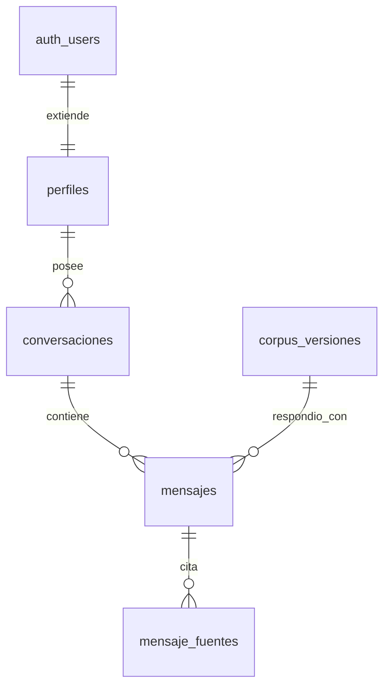

# Historial de chats — esquema de base de datos

> **Estado: propuesta.** Nada de esto está implementado. Faltan decisiones que
> están al final del documento y que cambian el esquema.

## Relacional, sobre Postgres

Supabase **es** Postgres, así que la elección viene dada. Pero encaja igual:

- Lo que se guarda es una jerarquía estricta —usuario → conversación → mensaje →
  fuentes citadas— con integridad referencial que importa: borrar una
  conversación tiene que llevarse sus mensajes y sus citas. En Postgres es un
  `ON DELETE CASCADE`; en un documental es código de aplicación que hay que
  acordarse de escribir.
- **Row-level security** hace cumplir "cada usuario ve solo lo suyo" en la
  propia base de datos, no en el código.
- **pgvector** ya está ahí. Hoy el índice son 9 MB en numpy y va sobrado, pero
  `rag/index.py` deja escrito que la migración toca cuando el corpus crezca o
  haya varios usuarios — las dos cosas están a punto de pasar.

## Diagrama



`auth_users` es `auth.users`, que gestiona Supabase. No se toca: se cuelga
`perfiles` de ella para lo que es nuestro.

## Las dos decisiones que no son obvias

### 1. Las citas se copian, no se referencian

`mensaje_fuentes` guarda `cita` y `texto` completos, no solo el `unidad_id`.
Duplica datos a propósito.

El corpus **vive fuera de Postgres** —ficheros `.npy` y `.json`— y va a
cambiar. En cuanto se cargue el texto consolidado de la Ley 30424, el artículo 3
dirá otra cosa. Si la conversación de marzo solo guardó
`ley_30424::ley::art_3`, en junio estaría citando un texto que nadie leyó.

En una herramienta de compliance el historial es el registro de qué se
respondió y con qué base. `corpus_version_id` completa la foto.

### 2. Persistir el historial nos convierte en responsables de datos

Hoy las consultas no se guardan: se enmascara la PII antes de llamar al modelo
y ahí muere. Con historial pasaríamos a **almacenar consultas con DNI, nombres
y datos de casos reales**, atribuidas a una persona concreta.

Eso cae bajo la Ley 29733, la misma que está cargada en el corpus. Y la
anonimización actual es por patrones: reconoce DNI, RUC y correos, pero **no
reconoce nombres de persona**.

Hay que decidirlo antes de crear las tablas, porque cambia qué guarda cada
columna: texto enmascarado en vez del original, cifrado de `contenido`, o
borrado automático por antigüedad.

## Migración

```sql
-- ---------------------------------------------------------------- perfiles
create table public.perfiles (
  id         uuid primary key references auth.users(id) on delete cascade,
  nombre     text,
  rol        text not null default 'analista'
             check (rol in ('analista', 'admin')),
  creado_en  timestamptz not null default now()
);

-- -------------------------------------------------------- corpus_versiones
-- Qué corpus respondió. El índice vive fuera de Postgres, así que se
-- identifica por el hash del fichero de vectores.
create table public.corpus_versiones (
  id           uuid primary key default gen_random_uuid(),
  hash_indice  text not null unique,
  unidades     int  not null,
  normas       jsonb not null,   -- [{norma_id, nombre, estado_texto}, ...]
  creado_en    timestamptz not null default now()
);

-- ----------------------------------------------------------- conversaciones
create table public.conversaciones (
  id              uuid primary key default gen_random_uuid(),
  usuario_id      uuid not null references public.perfiles(id) on delete cascade,
  titulo          text not null default 'Nueva consulta',
  creada_en       timestamptz not null default now(),
  actualizada_en  timestamptz not null default now(),
  archivada_en    timestamptz          -- borrado suave; null = activa
);

create index conversaciones_por_usuario
  on public.conversaciones (usuario_id, actualizada_en desc);

-- ------------------------------------------------------------------ mensajes
create table public.mensajes (
  id                 uuid primary key default gen_random_uuid(),
  conversacion_id    uuid not null
                     references public.conversaciones(id) on delete cascade,
  -- Ordena la conversación. No usar creado_en: dos mensajes pueden caer en el
  -- mismo milisegundo y el orden dejaría de ser determinista.
  orden              int  not null,
  rol                text not null check (rol in ('usuario', 'asistente')),
  contenido          text not null,
  advertencias       text[] not null default '{}',
  diagrama           text,
  modelo             text,        -- cuál respondió; hay cadena de respaldo
  corpus_version_id  uuid references public.corpus_versiones(id),
  creado_en          timestamptz not null default now(),
  unique (conversacion_id, orden)
);

create index mensajes_por_conversacion
  on public.mensajes (conversacion_id, orden);

-- ----------------------------------------------------------- mensaje_fuentes
create table public.mensaje_fuentes (
  id         uuid primary key default gen_random_uuid(),
  mensaje_id uuid not null references public.mensajes(id) on delete cascade,
  etiqueta   text not null,     -- F1, F2... lo que cita el cuerpo del texto
  -- Sin clave foránea a propósito: el corpus no está en Postgres.
  unidad_id  text not null,     -- ley_29733::ley::art_39
  norma_id   text not null,     -- para agregar sin parsear el id
  cita       text not null,     -- copia, ver decisión 1
  texto      text not null,     -- copia del articulado
  score      real not null,
  unique (mensaje_id, etiqueta)
);
```

## Row-level security

```sql
alter table public.perfiles        enable row level security;
alter table public.conversaciones  enable row level security;
alter table public.mensajes        enable row level security;
alter table public.mensaje_fuentes enable row level security;

create policy "mi perfil" on public.perfiles
  for all using (id = auth.uid()) with check (id = auth.uid());

create policy "mis conversaciones" on public.conversaciones
  for all using (usuario_id = auth.uid())
          with check (usuario_id = auth.uid());

-- Mensajes y fuentes heredan el dueño por la cadena de claves foráneas.
create policy "mensajes de mis conversaciones" on public.mensajes
  for all using (exists (
    select 1 from public.conversaciones c
    where c.id = mensajes.conversacion_id and c.usuario_id = auth.uid()
  ));

create policy "fuentes de mis mensajes" on public.mensaje_fuentes
  for all using (exists (
    select 1 from public.mensajes m
    join public.conversaciones c on c.id = m.conversacion_id
    where m.id = mensaje_fuentes.mensaje_id and c.usuario_id = auth.uid()
  ));

-- El corpus es común a todos: se lee, no se escribe desde el cliente.
alter table public.corpus_versiones enable row level security;
create policy "corpus legible" on public.corpus_versiones
  for select using (auth.role() = 'authenticated');
```

Con esto, el aislamiento entre usuarios deja de depender de que nadie olvide un
`where usuario_id = ...`. Postgres lo impone aunque la consulta pida la tabla
entera.

## Qué falta decidir

1. **Qué se guarda del texto del usuario** — original, enmascarado o cifrado, y
   si hay borrado por antigüedad. Es la decisión 2 y bloquea todo lo demás.
2. **Qué pasa con la clave compartida** — con cuentas reales la API valida el
   JWT del usuario; la clave se queda para servicio a servicio o se retira. El
   punto de enganche está aislado en `verificar_clave` (`backend/auth.py`).
3. **Si hay roles desde el principio** — `perfiles.rol` está puesto, pero no
   hace falta usarlo hasta que alguien deba ver lo de otro.
4. **Dónde vive Supabase** — el plan gratuito suspende proyectos inactivos.
