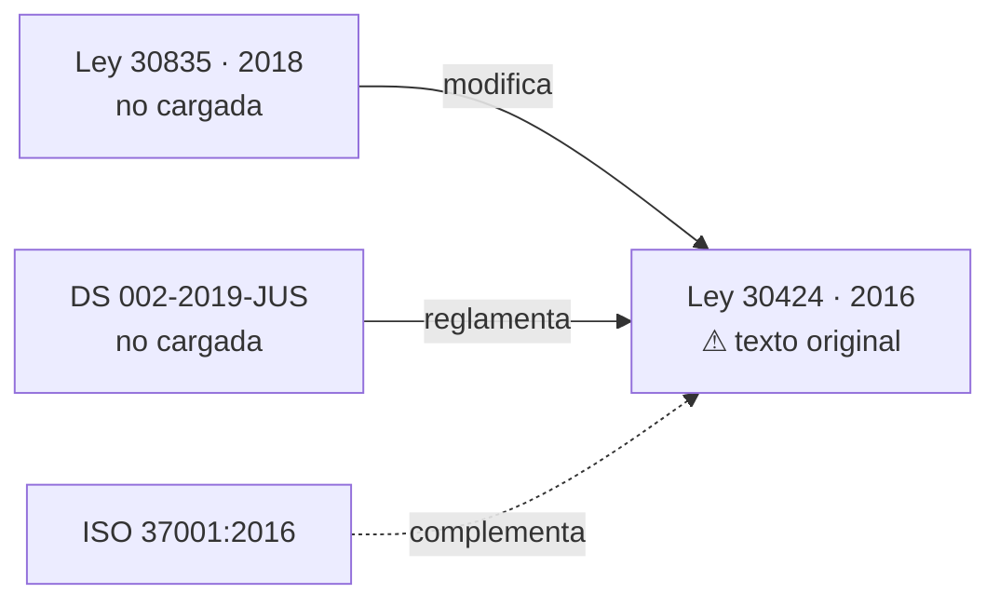

# Grafo de trazabilidad — propuesta

> **Estado: diseño, no implementado.** Este documento propone el modelo de
> datos. Nada de esto existe todavía en el código.

## El problema

Hoy no hay forma de responder preguntas como:

- ¿Qué norma modificó a la Ley 30424, y en qué quedó el artículo 5?
- ¿Qué reglamento desarrolla esta ley?
- El artículo que me acaban de citar, ¿sigue vigente?
- ¿Por qué está esta norma en el corpus?

Las respuestas existen a medias, repartidas y en prosa: `registry.notas` lo
cuenta en lenguaje natural, y cada unidad guarda un `modificatorias` parseado de
su propio texto. Ninguno de los dos se puede consultar ni pintar.

Y es la misma carencia que hace que el corpus se vuelva opaco al crecer. Con 5
normas se lleva en la cabeza; con 40, no.

## Qué existe ya como insumo

Más de lo que parece:

| Dato | Dónde está | Qué le falta |
|---|---|---|
| Modificatorias por artículo | `unidad.modificatorias` — `[{tipo, numero, fecha_publicacion_texto}]`, parseado del texto | No hay equivalente a nivel de norma |
| Vigencia por artículo | `unidad.vigente` — `False` si el texto dice que fue derogado | Solo detecta lo que el propio texto declara |
| Ley ↔ reglamento | `unidad.documento` — `ley`, `decreto_aprobatorio`, `reglamento` | Solo dentro de un mismo PDF |
| Estado del texto | `registry.notas`, en prosa | No consultable |
| Por qué está en el corpus | **en ningún sitio** | — |

O sea: las aristas *dentro* de una norma existen. Faltan las aristas **entre**
normas, que son justo las que el usuario quiere ver.

## Modelo propuesto

Dos capas. La primera resuelve el 80% y es barata.

### Capa 1 — relaciones a nivel de norma

Tres campos nuevos en `NormaMeta` (`ingestion/registry.py`):

```python
@dataclass
class NormaMeta:
    ...
    # Por qué esta norma está en el corpus. Frase de una línea, en lenguaje
    # de negocio, no de derecho. Se muestra al usuario en el panel lateral.
    por_que_relevante: str = ""

    # Estado del texto cargado, como dato y no como prosa.
    #   "consolidado"   texto actualizado a una fecha
    #   "original"      publicación original, sin modificatorias posteriores
    #   "parcial"       solo una parte del documento
    estado_texto: str = "consolidado"
    consolidado_a: str | None = None       # "2022-04-28"

    # Aristas del grafo. Cada una apunta a un norma_id del corpus, o a un
    # identificador externo si la norma referida no está cargada.
    relaciones: list[Relacion] = field(default_factory=list)


@dataclass
class Relacion:
    tipo: str        # ver tabla de abajo
    destino: str     # "ley_30424", o "ley_30835" si aún no está cargada
    nota: str = ""
    en_corpus: bool = False   # ¿el destino está cargado?
```

Tipos de relación, deliberadamente pocos:

| `tipo` | Significado | Ejemplo |
|---|---|---|
| `modifica_a` | Cambia el texto de otra norma | Ley 30835 → Ley 30424 |
| `reglamenta_a` | Desarrolla otra norma | DS 002-2019-JUS → Ley 30424 |
| `deroga_a` | Deja sin efecto otra norma | |
| `sustituye_a` | Texto consolidado que reemplaza a una versión previa | |
| `complementa_a` | Se aplica junto a otra sin modificarla | ISO 37001 ↔ Ley 30424 |

`en_corpus: False` es la parte valiosa: deja registrado **lo que sabemos que
falta**. Hoy que la Ley 30835 modifica a la 30424 solo consta en una nota en
prosa; como arista queda explícito que hay un hueco, y el grafo lo puede pintar
en gris con un "no cargada".

### Capa 2 — trazabilidad por artículo

Solo si la capa 1 se queda corta. Consiste en resolver `unidad.modificatorias`
—que hoy es texto parseado— contra normas concretas, para poder decir *"el
artículo 5 de la 30424 fue modificado por el artículo 2 de la Ley 30835"*.

Es bastante más caro: requiere cotejo manual o un texto consolidado que declare
las modificatorias artículo por artículo. **No lo abordaría hasta tener la capa 1
funcionando y saber que hace falta.**

## Cómo se pinta

El grafo es pequeño (decenas de nodos, no miles), así que no hace falta ninguna
librería de grafos: **Mermaid ya está en el frontend** y sirve.



Nodo en color pleno = cargada en el corpus. Nodo en gris = conocida pero no
cargada. Eso convierte el grafo en el mapa de cobertura además del de
trazabilidad, que es la parte que de verdad se usa a diario.

Dónde ponerlo en la interfaz: en el panel lateral, como una sección desplegable
bajo el filtro por materia; y al abrir una fuente en el panel de citas,
mostrando el sub-grafo de esa norma.

## Endpoint

```
GET /api/grafo  ->  { nodos: [...], aristas: [...] }
```

Se construye desde `REGISTRY` en memoria, sin tocar el índice. Es barato y
cacheable: el grafo solo cambia cuando cambia el registry.

## Por dónde empezar

1. Añadir los campos a `NormaMeta` con valores por defecto (no rompe nada).
2. Rellenar `por_que_relevante` y `relaciones` de las 5 normas actuales. Es
   media hora de trabajo y hay que hacerla con la fuente delante, no de memoria.
3. `GET /api/grafo`.
4. Pintar el Mermaid en el panel lateral.
5. Hacer obligatorio `por_que_relevante` en [INGESTA.md](INGESTA.md) para toda
   norma nueva.

El paso 2 es el que hay que hacer **antes** de la próxima carga grande. Después,
con cuarenta normas encima, reconstruir de dónde salió cada una y por qué es
mucho más caro que anotarlo al entrar.
